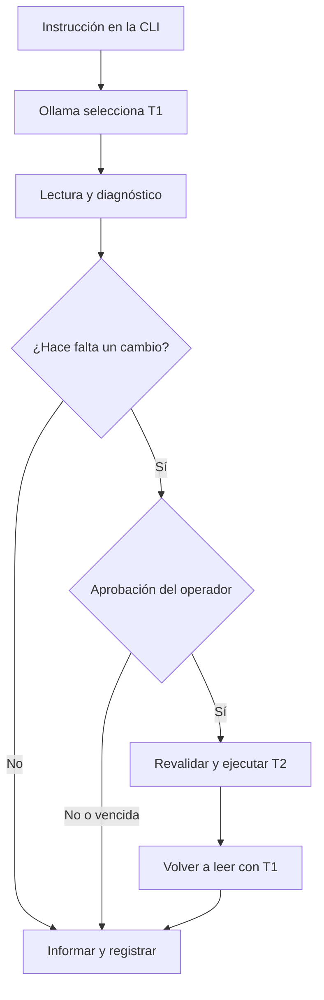

# Guía para terminar NetAgent-Ops

**Proyecto 2 · Grupo 5 · ITIEL-13 Redes Programables**  
**Estado de referencia: 20 de noviembre de 2026**

## Dónde estás y qué hacer primero

**Estás empezando la fase de integración del agente para el avance.** Ya demostraste que T1 y T2 funcionan sobre R1 en GNS3: T2 instaló la ruta vía `10.0.0.1`, devolvió `changed: true` y `verificada: true`, y T1 confirmó el siguiente salto en una ejecución aparte. Instalaste Ollama, Qwen3 y LangGraph. Falta demostrar que el agente puede interpretar la instrucción, usar T1, pedir aprobación, invocar T2, volver a consultar T1 y registrar la sesión.

| Componente | Estado según la evidencia |
|---|---|
| Topología base y VLAN 10 | Montadas. PC1 recibe respuestas de su gateway R2. La captura confirma el cableado y los puertos. |
| Gestión desde Garuda | R1 por SSH y Netmiko, confirmado. R2 y los switches tuvieron conectividad IP durante el diagnóstico. Falta validar SSH en R2, SW1 y SW2. |
| R1 · T1 y T2 | Lectura, primer cambio y verificación independiente confirmados. Falta evidencia de la segunda ejecución de T2 con `changed: false`. |
| Ollama, Qwen3 y LangGraph | Instalados según tu reporte. Falta observar una llamada estructurada con el modelo exacto. |
| Archivos del agente y Ansible | La estructura existe. `tree` muestra nombres, así que revisá qué archivos están vacíos antes de editar. T3, T4 y el flujo integrado todavía no tienen evidencia de funcionamiento. |
| Entrega | Faltan registros de sesión, demostraciones integradas, README e informe final. |

**Tu siguiente sesión:** repetí T2 con la ruta actual para comprobar idempotencia, hacé la prueba de `tool_calls` del paso 2 y prepará R1 sin ruta por defecto para probar la CLI. En paralelo, alguien del grupo puede habilitar y comprobar SSH en R2 y los switches.

## 1. Cerrá la prueba manual de R1 y prepará el laboratorio

### 1.1 Inventariá el repositorio sin exponer secretos

Desde la raíz de `NetAgent-Ops`, con `.venv` activado:

```fish
git status --short
find agente herramientas ansible -type f -size 0 -print
python -m pip check
python -m pip show netmiko paramiko langgraph
ollama list
git ls-files -- .env .venv .venv-ssh-test
```

Anotá la etiqueta exacta del modelo y las versiones probadas en el README. Revisá que `.env`, `.venv/`, `.venv-ssh-test/` y las contraseñas de Vault queden fuera del ZIP y de Git. En las configuraciones compartidas se ven hashes Cisco tipo 5 de GW y R1. Cambiá esas dos contraseñas de laboratorio y ocultá las líneas `username … secret …` en capturas, respaldos y evidencias. Las claves SSH del servidor y sus huellas son distintas de las contraseñas locales. [Cisco explica el formato de los secretos tipo 5.](https://www.cisco.com/c/en/us/about/trust-center/resilient-infrastructure/protecting-secrets.html)

### 1.2 Capturá la idempotencia de T2

La configuración que compartiste muestra que R1 todavía tiene la ruta del caso 1. Aprovechá ese estado:

```fish
python herramientas/configurar_ruta.py --equipo r1 --destino 0.0.0.0/0 --siguiente-salto 10.0.0.1
python herramientas/estado_router.py --equipo r1
```

Esperado: T2 devuelve `ok: true`, `changed: false` y `verificada: true` sin pedir `SI`. T1 devuelve `ruta_por_defecto: "10.0.0.1"`. Guardá la evidencia. Si la ruta cambió desde la captura, confirmá el estado con T1 y prepará la prueba según el resultado.

Para arrancar el caso 1 desde cero, retirala **desde la consola de R1** y volvé a ejecutar T1 desde Garuda:

```text
configure terminal
no ip route 0.0.0.0 0.0.0.0 10.0.0.1
end
```

Esperado en T1: `ok: true`, `ruta_por_defecto: null` y los enlaces `Fa0/0` y `Fa0/1` en `up/up`. Conservá la ruta específica `192.168.122.1/32`, que permite a R1 responder a Garuda durante la prueba. Anotá si cada reset quedó en `running-config` o también en `startup-config` para poder repetirlo después de un reinicio.

### 1.3 Interpretá el ping actual de PC1

El mensaje `Destination host unreachable` viene de `192.168.10.1`, la subinterfaz de R2 para la VLAN 10. PC1 ya alcanza su gateway. La configuración compartida muestra una ruta por defecto en R1 y solo una ruta de retorno a Garuda en R2. Verificá en R2 con `show ip route` y `ping 10.1.1.1`. Si ves `Gateway of last resort is not set` y el ping interno funciona, la ruta que falta para completar la cadena de salida es la de R2 vía `10.1.1.1`.

- **Para el avance**, podés demostrar la ruta de R1 con T1 antes y después. El ping de PC1 a un destino externo requiere también la ruta de R2.
- **Para el caso 3**, conservá R2 sin ruta por defecto al inicio y dejá la ruta de R1 instalada. PC1 está en VLAN 10 y sirve para probar el camino de salida de esa VLAN. Para mostrar salida específicamente desde VLAN 30, podés agregar un VPCS de prueba con `192.168.30.10/24`, gateway `192.168.30.1` y un puerto de acceso libre preparado manualmente. La demostración básica del P1 verifica el caso mediante las lecturas del agente.
- Si hacés una comprobación manual de salida por NAT1, usá destinos dentro del alcance autorizado del laboratorio. Con ambas rutas ya instaladas, comprobá primero el enlace de R2 a R1, la ruta y el enlace DHCP de GW. Si probás un destino externo autorizado y el tráfico falla, mirá `show ip nat translations` y `show access-lists NETAGENT-PAT` en GW mientras circula el tráfico. Para una demo reproducible, podés usar un destino de prueba interno de GW como en el P1. No necesitás resolver DNS para probar una IP.

### 1.4 Completá SSH en R2, SW1 y SW2

| Alias del inventario | IP de gestión | Acceso permitido desde |
|---|---|---|
| `r1` | `10.1.1.1` | Garuda `192.168.122.1` |
| `r2` | `192.168.99.1` | Garuda `192.168.122.1` |
| `sw1` | `192.168.99.11` | Garuda `192.168.122.1` |
| `sw2` | `192.168.99.12` | Garuda `192.168.122.1` |

1. En Garuda, corré `ip -4 route get 10.1.1.1` y `ip -4 route get 192.168.99.11`. Deben usar `virbr0`, la IP DHCP **actual** de GW como siguiente salto y `src 192.168.122.1`. Si reiniciaste y GW cambió de IP, verificá en `show ip interface brief` de GW y actualizá únicamente las rutas del laboratorio en Garuda. R1 y R2 mantienen su retorno específico a `192.168.122.1/32`. Los switches usan `no ip routing` e `ip default-gateway 192.168.99.1`.
2. En cada consola de **R2, SW1 y SW2**, revisá `show ip ssh` y `show running-config | section line vty`. En tu salida, los tres muestran `login` y todavía requieren configurar la cuenta local y `login local`. El certificado HTTPS que aparece en los switches por sí solo no demuestra que el servidor SSH esté listo.
3. En modo configuración, definí `ip domain-name netagent.local` y `username netagent privilege 15 secret TU_CLAVE_DE_LAB`, reemplazando el marcador en la consola. Si SSH requiere una clave, ejecutá `crypto key generate rsa` y elegí `2048` si IOS pide el tamaño. Revisá las claves existentes antes de reemplazarlas. Configurá `ip ssh version 2` y limitá las VTY al origen confirmado. [Configuración de SSH en Cisco IOS.](https://www.cisco.com/c/en/us/td/docs/ios/sec_user_services/configuration/guide/12_4/sec_securing_user_services_12-4_book/sec_secure_shell_v2.html)

   ```text
   ip access-list standard NETAGENT-SSH
    permit host 192.168.122.1
   exit
   line vty 0 4
    login local
    transport input ssh
    access-class NETAGENT-SSH in
   exit
   end
   show ip ssh
   ```

   Si hay rangos VTY adicionales, aplicá la misma política. Probá los accesos desde Garuda antes de cerrar las consolas. Guardá con `copy running-config startup-config` al confirmar cada equipo.
4. Probá `ssh netagent@192.168.99.1`, `ssh netagent@192.168.99.11` y `ssh netagent@192.168.99.12`. Si R2 ofrece los mismos algoritmos heredados que R1, podés repetir para ese destino el comando que funcionó en R1 con sus tres opciones `-o`. En los switches, probá primero SSH normal. Registrá las claves de host verificadas en `known_hosts` antes de probar Netmiko o Ansible. [Compatibilidad puntual de OpenSSH.](https://www.openssh.org/legacy.html)

   ```fish
   ssh -o KexAlgorithms=+diffie-hellman-group1-sha1 \
     -o HostKeyAlgorithms=+ssh-rsa -o Ciphers=+aes128-cbc netagent@192.168.99.1
   ```

5. Ejecutá `python herramientas/estado_router.py --equipo r2`. Esperado: `ok: true`, `Fa0/1.30` con IP `192.168.30.1` y `ruta_por_defecto: null` en el escenario inicial del caso 3. Guardá esta lectura y las sesiones de SSH como evidencia de acceso. GW cumple el papel de infraestructura del laboratorio definido en el P1, fuera de las herramientas de cambio.

Si se repiten pérdidas en el enlace **SW1 `Et0/0` ↔ R2 `Fa0/1`**, compará el dúplex efectivo y los errores con `show interfaces Ethernet0/0` y `show interfaces FastEthernet0/1`. El aviso CDP ya aparece en tu salida. Medí si hay errores o colisiones antes de decidir un ajuste de velocidad y dúplex compatible con ambos extremos.

**Criterio de cierre:** Garuda consulta R1 y R2 por Netmiko y abre sesión SSH a ambos switches. Para avanzar con Ollama basta con que R1 esté listo.

## 2. Verificá function calling de Ollama

Desde Garuda, comprobá la API local y el modelo exacto:

```fish
ollama list
curl -fsS http://127.0.0.1:11434/api/tags | python -m json.tool
python -c 'from langgraph.graph import StateGraph; print("LangGraph OK")'
```

En la prueba siguiente, sustituí `qwen3:8b` por la etiqueta que instalaste si es distinta. La petición solo declara una función y muestra la decisión del modelo. No ejecuta Python de red.

```fish
curl -fsS --max-time 180 http://127.0.0.1:11434/api/chat \
  -H 'Content-Type: application/json' \
  -d '{
    "model": "qwen3:8b",
    "stream": false,
    "messages": [
      {"role": "system", "content": "Para inspeccionar un router, llama a la herramienta de lectura declarada."},
      {"role": "user", "content": "Revisá el estado de las interfaces y la ruta por defecto de r1."}
    ],
    "tools": [{
      "type": "function",
      "function": {
        "name": "leer_estado_router",
        "description": "Consulta interfaces y ruta por defecto de un router autorizado.",
        "parameters": {
          "type": "object",
          "properties": {"equipo": {"type": "string", "enum": ["r1", "r2"]}},
          "required": ["equipo"],
          "additionalProperties": false
        }
      }
    }]
  }' | python -m json.tool
```

Buscá en `message.tool_calls` una función con `name: leer_estado_router` y `arguments: {"equipo": "r1"}`. Una respuesta de texto que diga que leyó R1 no valida el *function calling*. Si el servidor no contesta, revisá `systemctl status ollama.service`. Si Ollama devuelve un error HTTP y querés ver el mensaje completo, repetí usando `--fail-with-body -sS` en lugar de `-fsS`. Guardá la etiqueta, el digest de `/api/tags` y una respuesta de prueba. Repetí con las cuatro definiciones cuando el catálogo esté completo. [Formato de funciones y respuestas de Ollama.](https://docs.ollama.com/capabilities/tool-calling)

## 3. Integrá el avance con R1

### 3.1 Orden para llenar los archivos del agente

| Archivo | Qué implementar primero |
|---|---|
| `agente/catalogo.py` | Nombres públicos, descripción, esquema JSON, tipo lectura/cambio, roles y asociación fija a T1 y T2. |
| `agente/validaciones.py` | Rechazo de nombres desconocidos y argumentos extra. Validación de alias, tipos, destino y siguiente salto conforme a la política del laboratorio. |
| `agente/llm.py` | Cliente para `POST /api/chat` en Ollama local. Envía mensajes y definiciones, devuelve llamadas estructuradas. Maneja tiempo de espera y respuesta inesperada. Podés usar la librería estándar `urllib.request` o declarar el cliente elegido en `requirements.txt`. |
| `agente/gateway.py` | Ejecuta solo manejadores del catálogo con argumentos validados. Verifica aprobación antes de un cambio y valida la salida de cada herramienta. |
| `agente/aprobaciones.py` | Emite y consume aprobaciones de un solo uso con caducidad de cinco minutos, ligadas a operación, argumentos normalizados, operador y solicitud. |
| `agente/controlador.py` | Maneja la sesión, el acceso a credenciales y la auditoría. Muestra la propuesta y procesa la respuesta humana. |
| `agente/grafo.py` | Conecta los pasos de lectura, evaluación, propuesta, aprobación, ejecución y verificación. |
| `agente/main.py` | Entrada de terminal. Lee la instrucción, muestra la decisión y el resultado. Reservá `python -m agente.main` como comando de entrada una vez implementado. |
| `agente/ejecutar_playbook.py` | Completalo en el paso 4 para adaptar Ansible a la misma interfaz del catálogo. |

Primero conectá Ollama con **T1 solamente**. Una vez validada la función y sus argumentos, ejecutá `estado_router.py --equipo r1`. Si lo llamás como proceso, usá `sys.executable`, argumentos como lista, tiempo de espera y lectura explícita de JSON en stdout. También podés exponer una función importable en T1 y conservar su CLI. Pasá al modelo solo el estado operativo normalizado como resultado de la herramienta. Nunca incluyás las credenciales en mensajes, argumentos de Ollama, estado del grafo o registros.

**Prueba de la primera integración:** pedí «Revisá el estado de R1». El agente debe mostrar la consulta seleccionada y devolver interfaces y ruta reales. Probá también con un alias fuera del inventario o argumentos extra. Esperado: rechazo sin invocar Netmiko. Antes de pasar a cambios, probá un fallo SSH para comprobar que `ok: false` no se interpreta como ruta ausente.

### 3.2 Mové la confirmación al flujo del agente

T2 ya tiene buena parte de la lógica: consulta la tabla y la configuración, revisa enlaces y red conectada, aplica un comando fijo y verifica. Su `input()` actual está en la CLI del script. Extraé la lógica de red a una función reutilizable y conservá la confirmación en la CLI manual para seguir pudiendo ejecutar `configurar_ruta.py` por separado. En la CLI del **agente**, la aprobación pasa por el controlador y el gateway antes de llamar esa función. Usá el mismo inventario y la validación estricta de la clave del host en las dos vías.



1. Registrá la petición con un identificador de sesión y de solicitud. El modelo puede llamar T1 para leer y proponer T2 después de recibir el JSON. La propuesta identifica `r1`, `0.0.0.0/0`, `10.0.0.1` y el motivo. El gateway verifica que T1 haya confirmado ruta ausente e interfaces relevantes `up/up`.
2. Para la pausa de LangGraph, usá un checkpointer y un `thread_id` por sesión. En el nodo de aprobación, `interrupt(propuesta)` devuelve el control a la CLI. La CLI muestra los datos, obtiene la decisión real y reanuda con `Command(resume=...)` usando el mismo `thread_id`. Al reanudar puede volver a ejecutarse el nodo interrumpido. Mantené la escritura a IOS en un nodo posterior. Un checkpointer en memoria sirve para la demo en un proceso. El historial de auditoría se escribe aparte en disco. [Pausas y reanudación en LangGraph para Python.](https://docs.langchain.com/oss/python/langgraph/interrupts)
3. Antes de escribir, validá el rol, el identificador de solicitud, los argumentos exactos, la vigencia y el preestado. Si ya quedó instalada la ruta correcta, informá que el estado deseado ya existe. Ante otro cambio material de preestado, detenete y generá una nueva propuesta. Consumí la aprobación en el gateway antes del cambio y descartala al cerrar la sesión. La respuesta del modelo o un campo `approved` en sus argumentos carecen de autoridad.
4. Ejecutá T2. Si hay pérdida de sesión o verificación dudosa luego de escribir, reportá estado incierto y consultá T1 antes de plantear otro intento. Evitá reintentos automáticos de escritura. Si T2 termina correctamente, invocá T1 de nuevo y comprobá `ruta_por_defecto == "10.0.0.1"`. Comunicá éxito solo con la lectura posterior válida.
5. Guardá un archivo `registros/sesiones/<id>.jsonl` por sesión, con fecha y hora en cada evento, instrucción, operador, herramienta, argumentos, propuesta, decisión, código/estado de ejecución, salida JSON y verificación. Ejemplo de secuencia: `solicitud` → `lectura_previa` → `propuesta` → `aprobacion` → `ejecucion` → `verificacion` → `resultado`. Conservá también los rechazos y errores. Registrá únicamente datos operativos pertinentes y ocultá secretos antes de guardar. El P1 también pide correlación, duración y límites de tiempo por herramienta.

**Criterio del avance:** desde la CLI, demostración en vivo de R1 sin ruta → diagnóstico real → aprobación única → ruta aplicada → lectura independiente → registro. Ensayá también el rechazo y conservá la prueba manual de `changed: false`. El agente puede identificar que el estado ya es correcto y omitir una nueva propuesta. La segunda invocación directa de T2 prueba la idempotencia de la herramienta.

## 4. Implementá T3 y T4 con Ansible

### 4.1 Inventario, configuración y credenciales

Conservá la estructura `all.children.routers_ios.hosts` que ya usa T1. Incorporá los switches al mismo archivo. Si el inventario ya tiene variables, fusioná los bloques para evitar claves duplicadas.

```yaml
all:
  vars:
    ansible_connection: ansible.netcommon.network_cli
    ansible_network_os: cisco.ios.ios
  children:
    routers_ios:
      hosts:
        r1:
          ansible_host: 10.1.1.1
        r2:
          ansible_host: 192.168.99.1
    switches_ios:
      vars:
        ansible_user: "{{ vault_usuario }}"
        ansible_password: "{{ vault_password }}"
      hosts:
        sw1:
          ansible_host: 192.168.99.11
        sw2:
          ansible_host: 192.168.99.12
```

- Ubicá el Vault junto al inventario, en `ansible/inventory/group_vars/switches_ios/vault.yml`, o cargá explícitamente el archivo actual desde el playbook. Con el inventario en `ansible/inventory/` y los playbooks en `ansible/playbooks/`, `ansible/group_vars/all/` no se descubre por proximidad. Esta guía usa la primera ubicación. Si el archivo anterior contiene datos, inspeccionalo localmente con el método apropiado antes de moverlo. [Cómo descubre Ansible las variables de grupos.](https://docs.ansible.com/projects/ansible/latest/user_guide/intro_inventory.html)
- Si aún no existe un Vault cifrado, creá la carpeta y usá `ansible-vault create ansible/inventory/group_vars/switches_ios/vault.yml`. Si ya existe cifrado en esa ubicación, usá `ansible-vault edit`. Definí adentro `vault_usuario` y `vault_password`. Si los equipos usan contraseñas distintas, usá variables por host cifradas. Con `netagent` en privilegio 15, comprobá si el prompt ya entra a `#` antes de agregar `become: true`. Para Python, podés seguir con `NETAGENT_SSH_USERNAME` y `NETAGENT_SSH_PASSWORD` inyectadas al ejecutar, o un proveedor local que lea el mismo almacén protegido. Documentá la decisión frente al P1. [Uso de Ansible Vault.](https://docs.ansible.com/projects/ansible/latest/vault_guide/vault_using_encrypted_content.html)
- En `ansible/ansible.cfg` mantené la validación de claves de host. Desde la raíz del repo, usá `env ANSIBLE_CONFIG="$PWD/ansible/ansible.cfg"` antes del comando y `-i ansible/inventory/hosts.yml`. Para la integración sin interacción, el adaptador puede recibir una fuente de desbloqueo de Vault configurada por el operador, por ejemplo `ANSIBLE_VAULT_PASSWORD_FILE` con un archivo externo al repo y permisos restringidos. Usá `--ask-vault-pass` en pruebas manuales. La contraseña de Vault no va en el JSON de entrada ni en el ZIP.

```fish
ansible-galaxy collection list
ansible-galaxy collection install cisco.ios ansible.netcommon
env ANSIBLE_CONFIG="$PWD/ansible/ansible.cfg" ansible \
  -i ansible/inventory/hosts.yml switches_ios --ask-vault-pass \
  -m cisco.ios.ios_command -a '{"commands":["show vlan brief"]}'
```

Ejecutá la instalación si falta alguna colección. El comando final debe devolver VLAN 10, 20 y 99 en ambos switches. Si falla, comprobá primero SSH directo, claves en `known_hosts`, credenciales de Vault y la colección. Revisá versiones y backend en caso de problemas con `network_cli`. Anotá las versiones de colecciones probadas en `ansible/requirements.yml` y las dependencias Python en `requirements.txt`. [Cisco IOS en Ansible.](https://docs.ansible.com/projects/ansible/latest/network/user_guide/platform_ios.html) [Conexión network_cli.](https://docs.ansible.com/projects/ansible/latest/collections/ansible/netcommon/network_cli_connection.html)

### 4.2 T3 · `leer_vlans.yml`

1. Trabajá con `gather_facts: false` y el grupo `switches_ios`. Validá `targets` como lista no vacía de alias únicos de ese grupo y `vlan_id` como entero de 1 a 4094. El diseño permite de 1 a 8 destinos, siempre dentro del inventario autorizado. Seleccioná los hosts después de validar la lista.
2. Usá `cisco.ios.ios_vlans` con `state: gathered` y guardá `gathered` por switch. Buscá el ID solicitado y devolvé `existe` y `nombre`. Conservá un resultado por equipo, incluidos destinos inaccesibles. Una falla de lectura es `ok: false`, porque deja incierto si la VLAN existe.
3. En `agente/ejecutar_playbook.py`, asociá cada nombre con su playbook fijo. Pasá los parámetros mediante JSON y limitá la ejecución a los alias validados. Generá `resultado_path` en el host de control, fuera de los argumentos que el LLM puede elegir. Podés usar un directorio temporal por invocación y un paso de agregación local que escriba el JSON una sola vez. Validá código de salida, JSON y cobertura de todos los destinos. El modelo recibe el resultado normalizado.

Fragmento de la tarea de consulta:

```yaml
- name: Consultar las VLAN del switch
  cisco.ios.ios_vlans:
    state: gathered
  register: vlans_actuales
```

Contrato esperado para el caso 2 antes de crear la VLAN, si ambos equipos responden:

```json
{
  "ok": true,
  "operation": "leer_vlans",
  "vlan_id": 30,
  "results": [
    {"equipo": "sw1", "ok": true, "existe": false, "nombre": null},
    {"equipo": "sw2", "ok": true, "existe": false, "nombre": null}
  ],
  "errores": []
}
```

### 4.3 T4 · `crear_vlan.yml`

1. Registrá `crear_vlan_switches` en el catálogo de cambios. Validá `targets` como en T3, `vlan_id` entre 2 y 4094, excluí 1002 a 1005 y protegé la VLAN de gestión. Validá `vlan_name` con `^[A-Z][A-Z0-9_-]{0,31}$`. El caso 2 usa `30` y `SERVIDORES`.
2. Antes de ofrecer el cambio, ejecutá T3 para todos los destinos. Si uno es inaccesible o la VLAN existe con un nombre distinto, detené toda la operación para revisión. Si ambos ya tienen el nombre correcto, informá que el estado deseado ya existe. Si falta en alguno y los demás están correctos, la propuesta debe identificar en cuáles hace falta.
3. Después de la aprobación, hacé que el playbook vuelva a leer todos los destinos **antes de la primera escritura**. Con una ejecución lineal, separá las tareas de prelectura, validación global y aplicación. Una lectura fallida o un conflicto debe bloquear la fase de aplicación en todos los destinos. Evitá ejecutar un cambio por host antes de que terminen las comprobaciones del grupo.
4. Usá `state: merged` solo donde falte la VLAN. Volvé a leer la VLAN en cada destino y guardá la configuración del equipo modificado que quedó verificado con `cisco.ios.ios_config` y `save_when: modified`, como plantea el P1. Ese guardado persiste el `running-config` del switch, así que partí de un estado base guardado antes de la demo. Reportá por equipo `ok`, `changed` y `verificada`. Si hay una falla después de una aplicación parcial, documentá cuáles equipos cambiaron y devolvé `ok: false` global.
5. El agente vuelve a llamar T3 por separado. El éxito completo requiere VLAN 30 con nombre `SERVIDORES` en ambos switches. Repetí la prueba y comprobá que devuelve `changed: false` por equipo. Probá también conflicto de nombre y equipo no alcanzable. Los trunks ya permiten 30. T4 configura el ID y el nombre.

Fragmento del paso de aplicación, dentro del flujo aprobado:

```yaml
- name: Crear la VLAN aprobada
  cisco.ios.ios_vlans:
    config:
      - vlan_id: "{{ vlan_id }}"
        name: "{{ vlan_name }}"
    state: merged
  register: cambio_vlan
  when: vlan_faltante
```

[Campos de salida y estados de ios_vlans.](https://docs.ansible.com/projects/ansible/latest/collections/cisco/ios/ios_vlans_module.html) [Guardado con ios_config.](https://docs.ansible.com/projects/ansible/latest/collections/cisco/ios/ios_config_module.html)

Cuando completes los playbooks, validá cada archivo con `ansible-playbook --syntax-check`, usando el mismo `ANSIBLE_CONFIG`, inventario y `--ask-vault-pass` de la prueba anterior. Luego probá primero T3 contra un switch, después T3 contra ambos y por último T4 con aprobación. Comprobá los dos dispositivos con T3 en otra invocación.

## 5. Completá el caso combinado de R2

1. Ampliá la versión actual de T2. Hoy limita `--equipo` a `r1` y la verificación a `10.0.0.1`. Conservá `0.0.0.0/0` como destino para los casos definidos y validá cada par router/siguiente salto con esta tabla. Si mantenés esta limitación frente al contrato genérico del P1, explicá su alcance en el catálogo final y en el informe.

   | Router | Siguiente salto aprobado | Red conectada que debe confirmar T2 | Interfaces relevantes |
   |---|---|---|---|
   | `r1` | `10.0.0.1` | `10.0.0.0/30` | `Fa0/0` `10.0.0.2` y `Fa0/1` `10.1.1.1`, ambas `up/up` |
   | `r2` | `10.1.1.1` | `10.1.1.0/30` | `Fa0/0` `10.1.1.2` y `Fa0/1.30` `192.168.30.1`, ambas `up/up` |

2. Derivá la verificación de la ruta del destino y siguiente salto validados. Quitá las referencias fijas a la IP de GW del análisis y mensajes de R2. Preservá los casos de R1, la detección de rutas en conflicto y las rutas de retorno de gestión.
3. Prepará el estado inicial: R1 con `0.0.0.0/0` vía `10.0.0.1`, VLAN 30 `SERVIDORES` en ambos switches, R2 sin ruta por defecto y `Fa0/1.30` activa. Usá el resultado del caso 2 para preparar la VLAN. Si necesitás restablecer R2, retirale solo su ruta por defecto en consola con `no ip route 0.0.0.0 0.0.0.0 10.1.1.1`.
4. Desde la CLI pedí «La VLAN 30 está creada, pero el servidor no tiene salida. Revisá los switches y R2». El flujo lee T3 primero, luego T1 en R2, propone T2 vía `10.1.1.1`, espera aprobación y ejecuta T2. Una nueva lectura T1 debe confirmar la ruta. Informá qué se observó en los switches y cuál fue el cambio en R2.
5. Si T3 detecta que falta la VLAN en algún switch, atendé primero la VLAN con una propuesta T4 independiente. Si encuentra un nombre en conflicto o una lectura fallida, detené el flujo para revisión. Cada cambio se aprueba por separado.

## 6. Ensayá, documentá y entregá

### Matriz de demostración

| Caso | Preparación | Evidencia mínima |
|---|---|---|
| 1 · Ruta de R1 | R1 sin default, enlaces arriba, acceso SSH activo | T1 inicial, propuesta y decisión, T2 `changed: true`, T1 final con `10.0.0.1`. Repetición directa `changed: false`. |
| 2 · VLAN 30 | VLAN 30 ausente de SW1 y SW2. Verificalo con `show vlan brief` o T3. Para resetear, retirala desde consola de ambos switches solo si forma parte del escenario de prueba. | T3 antes, aprobación, T4 por host y T3 después con `SERVIDORES` en ambos. Repetición sin cambios. |
| 3 · Ruta de R2 | Conservá la ruta del caso 1 y la VLAN del caso 2. R2 sin default. | T3 en ambos switches, T1 en R2, aprobación de su ruta, T2, T1 final con `10.1.1.1`. |
| Rechazo y fallo | Prepará una solicitud válida y respondé que no. Para otro ensayo, probá alias inválido o un destino de laboratorio sin SSH. | Registro de rechazo o error sin escritura y mensaje claro al operador. |

Ensayá los casos **1 → 2 → 3** con una copia o estado base restaurable. Conservá registros de prueba y de la demo. Si querés medir tiempos, separá tiempo del modelo, tiempo de SSH/Ansible y espera de confirmación, así la comparación con la operación manual del P1 puede reproducirse.

### Comprobación contra R1–R8 del P2

| Requisito P2 | Qué mostrar |
|---|---|
| R1 · Agente funcional | Llamadas estructuradas reales desde Ollama y flujo ejecutado en Garuda. |
| R2 · Cuatro herramientas | Catálogo con esquemas, dos scripts Python, dos playbooks y resultados JSON. |
| R3 · Catálogo cerrado | Rechazo de nombres, argumentos y destinos fuera del inventario, con ejecución mediante asociaciones fijas. |
| R4 · Acceso SSH/API | Pruebas desde el host de control a R1, R2, SW1 y SW2. En el inventario del P1, GW es infraestructura fuera del catálogo. |
| R5 · Confirmación y verificación | Aprobación humana vinculada a la operación y nueva lectura T1 o T3 después de cada cambio. |
| R6 · Idempotencia | Segunda prueba sin cambios para T2 y T4, con estado final intacto. |
| R7 · Registro | Un archivo por sesión con solicitud, herramienta, parámetros, aprobación, JSON y verificación. |
| R8 · Secretos | Variables de entorno o almacén protegido y Vault cifrado. Revisá código, prompt, registros y ZIP. La rúbrica indica una deducción de 10 puntos si se incluyen credenciales o claves API en código o prompt. |

### README, informe y ZIP

- **README.md.** Incluí topología, arranque de GNS3, dirección DHCP de GW y rutas en Garuda, Python y dependencias, Ollama y modelo, inventario y Vault, comando de la CLI, preparación de los tres casos y ubicación de los registros. Marcá los comandos que se ejecutan en Garuda y los que van en las consolas de GNS3.
- **`P2_Informe_Grupo5.pdf`.** Máximo 8 páginas. Cubrí arquitectura implementada, diferencias justificadas con el P1, catálogo final, instalación/ejecución y fragmentos del registro de cada caso. Documentá Garuda en lugar de Ubuntu 22.04, tus imágenes IOS 12.4/Dynamips e IOS XE 17.15 de laboratorio, las interfaces `Fa`/`Et`, NAT1 y `virbr0` en la gestión enrutada por GW, las rutas por VLAN frente al resumen del P1 y el destino de prueba que finalmente usés. Explicá que el acceso funciona con las rutas de retorno específicas durante las demos. Si limitás T2 a rutas por defecto o cambiás el modo de cargar credenciales, registralo también. No incluyás hashes ni imágenes Cisco en el ZIP.
- **Avance.** Archivo `P2_Avance_Grupo5.zip` con código y registro de esa sesión. Demostración de 10 minutos con todos los integrantes. El P2 tiene fechas discordantes: pág. 1 indica 30 de noviembre a 5 de diciembre, pág. 3 muestra 23 a 28 de noviembre, la rúbrica dice semana 11 y el formato semana 12. Confirmá la fecha en Campus Virtual o con el profesor. El documento indica subir el avance al cierre de la sesión.
- **Final.** Archivo `P2_Final_Grupo5.zip` con una carpeta `P2_Final_Grupo5/` que contenga `agente/`, `herramientas/`, `ansible/`, `registros/`, `README.md` y `P2_Informe_Grupo5.pdf`. Sumá `requirements.txt` y los archivos necesarios para reproducir la instalación. Demo en vivo de los tres casos, de 20 a 25 minutos por grupo. La ventana indicada es del **7 al 12 de diciembre de 2026**, con subida antes del inicio de la clase.
- Antes de subir, abrí el ZIP y comprobá que el inventario, los dos playbooks, el Vault cifrado si lo usás, los registros y el PDF estén en las rutas esperadas. Hacé un ensayo desde una copia limpia y verificá que la CLI funcione siguiendo el README. Incluí solo los registros aptos para compartir.

## Referencias del proyecto

- **P1 NetAgent-Ops, Grupo 5**, §§2.2–2.4, caps. 4–5 y conclusiones. [Proyecto 1](https://chatgpt.com/library?file_id=libfile_11ea0a868b808191b8d4a87ed89bce5d&account_id=personal)
- **Proyecto 2, Requerimientos Oficiales**, §§1–7 y rúbricas. [Proyecto 2](https://chatgpt.com/library?file_id=libfile_bc520952c038819189504bc3a3d6f9fa&account_id=personal)
